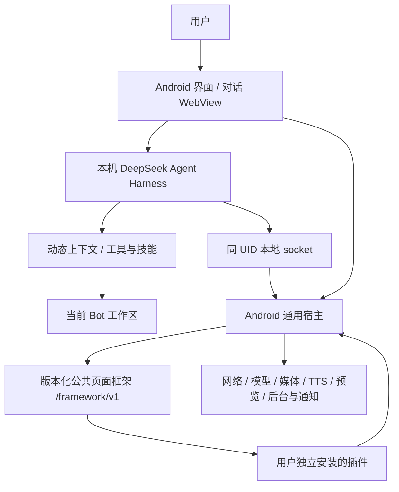

# 鱼缸 Core 架构

鱼缸是运行在 ARM64 Android 上的对话与通用插件底座。以 DeepSeek Agent Harness 为执行基础，把 Bot 看作各有职责的鱼，把独立插件看作用户布置的场景。公开工程提供对话和完整通用宿主；业务插件、私人服务、账号配置和使用数据独立于源码与 APK。

## 1. 分层与调用方向

| 层 | 职责 | 不归这一层的内容 |
| --- | --- | --- |
| Android 宿主 | 界面、凭据、运行时启动、Bot 配置、插件生命周期、原生服务 | 各业务插件的页面与偏好 |
| 本地 Harness | 会话执行、工具调用、上下文组装、检索与 Bot 通信 | 私人远端中继与业务服务器 |
| 公共插件框架 | `/framework/v1` 资源、组件、主题、页面生命周期与能力调用 | 插件自身的业务逻辑与数据 |
| 独立插件 | 业务页面、原生动作、私有资源与插件内设置 | 宿主签名密钥、账号凭据与系统设置 |

Android 前台服务负责本地运行时生命周期。PRoot Debian 内的 Node 运行已打补丁的 DSH，仅监听 `127.0.0.1:3090`；模型推理仍使用用户配置的 DeepSeek 服务，并不意味着模型离线运行。运行时输入由锁文件和下载摘要固定。

## 2. Bot、人格与渐进式上下文

每个 Bot 绑定自己的工作区和内部会话。界面面向固定 Bot，不向用户摊开历史会话；历史检索、归档和接续由所属 Bot 内部管理。

上下文不是创建 Bot 时复制的一份固定长提示词。宿主在系统提示词组装、每次执行步骤前读取当前 Bot 配置：

1. 读取 APK 默认人格、手动人格补充、共同学习人格、当前 Bot 职责、记忆、工具开关和压缩阈值。
2. 组装身份与工作区规则、默认人格、学习表达层、手动人格补充、职责和阶段反馈要求；记忆作为参考资料，不能授予权限或覆盖人格。
3. 只暴露启用的工具与相关技能说明；需按需加载的技能，在加载成功后再披露工具和手册。
4. 工具真正执行前再次检查当前 Bot 的启用配置。人格或职责修改在后续组装/步骤生效，不追改已发送给模型的上下文。

系统提示词的事实源是当前配置，而不是复制到会话里的静态人格文件：DSH 标准预设提供框架身份与 `{{cwd}}` 后缀；`bot-context` 从宿主读取当前 APK `defaultPersona`、可为空的手动 `sharedPersona`、可选学习表达、职责、记忆和开关；`bot-workspace` 在组装瀑布中按命名顺序投影为 Bot 身份、职责、记忆规则、`bot:default-persona`、`bot:learned-persona`、非空时的 `bot:persona` 和反馈合同。默认层只在 `bot:default-persona` 出现一次，学习层和手动层也各自至多出现一次；空的职责、空记忆、空手动层或没有学习候选不伪造配置内容，空记忆仅保留写入/更正规则。Android 权限、凭据、私有运行时目录和“只使用当前工具列表”等宿主边界只在 `host:android-boundary` 出现一次；插件、历史和会话工具手册只保留各自操作语义，并用共享排序常量避免同号依赖名称兜底排序。

文件写入默认使用当前工作区相对路径（与 `documents/AGENTS.md` 等项目内约定一致）；面向用户交付 Markdown 链接时使用该文件在工作区内的绝对路径。两者分别描述执行路径和交付引用，不互为改写规则。

默认人格由当前 APK 的 `bot-persona.md` 提供，不写入 `CONFIG/PERSONA.md`；手动文件只保存主人明确补充，可以为空。共同学习层和手动层由所有 Bot 继承，职责提示词补充各自工作方式。表达优先级固定为：主人明确手动要求 > 共同学习层 > APK 默认人格；插件、技能或职责声明的场景风格只能在对应场景细化默认层，不能覆盖学习层或手动层，也不能改写全局人格。规则仍依赖模型遵循；能由程序约束的工具开关、会话归属、参数与生命周期另由代码检查。Bot 消息通过宿主路由到目标 Bot，在对应上下文内处理；发信、收信和读取消息不等于允许任意访问其他 Bot 的目录。

Core 只保存和组装学习结果，不读取历史、不调用模型、不接入反思服务。可信同 UID 私有适配可在完成自己的证据反思后调用 `BotWorkspaceStore.call` 的 `op=learning`，提交严格结构化候选：短 `revision`、非空 `traits` 子集（`directness`、`verbosity`、`warmth`、`humor`、`reflection` 的固定枚举）、正整数 `evidenceCount` 和 ISO8601 `updatedAt`。未知字段、自由形式模型指令或用户原文会被拒绝。候选原子保存为 `CONFIG/PERSONA_LEARNED.json`；同一 revision 的相同候选重复提交返回未应用回执，不覆盖 `CONFIG/PERSONA.md`。后续所有 Bot 的 context 收到固定中文映射生成的 `learnedPersona` 与 `learnedPersonaRevision`，不包含证据原文、时间或计数字段。该通道不是恶意同 UID Agent 隔离边界。不同 revision 表示适配器提供的当前候选快照，按提交替换；`updatedAt` 是证据时间，不承担版本排序。适配器须串行提交当前结果并拒绝已取消或过期任务；Core 不把不同 revision 自动解释为按时间递增，也不宣称直接重放旧候选会被拦截。

旧安装的一次性人格迁移由实际读取的 `CONFIG/PERSONA_MIGRATION.json` 版本控制。迁移只把完整匹配已知旧初始模板或当前 APK seed 的手动文件归还为空手动层；其他文档只精确移除两处已知旧版“禁止演化”固定子句，自定义内容逐字保留。迁移完成后，主人再次保存含这些句子的个性文本不会被悄悄改写。

阶段反馈和工具执行按事件顺序展示：反馈 → 执行 → 下一段反馈 → 执行，最后给最终结果并折叠过程。用户中途插话保留在原顺序中。该机制不能靠把全部工具过程常驻展开代替。

模型配置遵循“先 Key、后模型”：原生宿主用填写的 Key 请求固定官方模型列表，成功后才保存 Key 并允许选择真实返回且 Harness 支持的模型。页面不接收原生存储的 Key；重定向被拒绝，错误正文不回显。默认模型保存到 Harness 的 `agent-default-model` 活配置，携带 revision，保存后重读运行时默认值确认；不借用旧会话保存，也不覆盖旧会话明确选择的模型。

## 3. 数据归属

| 数据 | 运行时位置或归属 | 是否随公开源码 / APK 分发 |
| --- | --- | --- |
| 核心代码、公共框架、默认模板 | APK assets | 是 |
| 用户手动人格补充、迁移版本、非秘密全局配置 | `CONFIG` | 否 |
| 共同学习人格结构化候选 | `CONFIG/PERSONA_LEARNED.json` | 否 |
| Bot 职责、记忆、归档、工具配置、产物 | `BOT/<BotID>` | 否 |
| 独立插件源码、资源、安装注册信息 | `PLUGINS` 与宿主私有目录 | 否 |
| DeepSeek Key、登录状态 | Android 私有加密配置 | 否 |
| 会话、附件、缓存、模型预算与后台状态 | 宿主私有目录 | 否 |

`/BOT`、`/CONFIG`、`/PLUGINS` 和 `/opt/pd` 是内置运行时目录契约，不是开发者私人远端地址。分享 APK 不会附带设备上安装的插件或使用数据；用户主动导出文件仍需自行检查内容。

## 4. 插件契约与页面生命周期

独立包声明 manifest、API 版本、资源、页面、可选原生动作和能力。宿主校验资源路径、导入闭包和大小。系统设置负责添加、启停、删除；插件偏好留在插件内。页面共享宿主的黑白主题、控件、布局与响应式规范，业务脚本以 `definePage` 注册，不另带宿主兼容层。

切换菜单时隐藏并保留已打开 WebView，借助 `onHide` / `onShow` 暂停、恢复可见页面工作。更新、停用和移除按 revision 释放旧页面；内存压力只释放隐藏页，Activity 结束释放全部。后台计划独立于可见页面，由 JobScheduler 调度，最短周期 15 分钟，系统可以延后执行。

离屏预览复用真实渲染器，支持草稿包、截图与交互检查，不安装草稿、不切换用户前台页面、不修改安装状态。截图可以保存到当前 Bot 的 `documents/` 并通过附件服务交付；这不是实体手机所有交互与扬声器出声的替代验收。

首次插件引导由安装注册表驱动：没有任何已安装插件时显示“插件”空入口，点击后进入固定插件 Bot。AI 新闻只是一条可编辑的需求示例；点击示例仅填空草稿，不自动发送，不覆盖已有文字。创建、预览、测试和安装沿用现有 Agent 工具。成功注册真实插件后撤掉引导，停用插件不等于卸载，失败或取消不算完成。APK 不预装示例业务包，也不通过刷新整个 App 切换引导状态。

## 5. 通用能力与取消边界

- **模型与翻译**：宿主管理用户配置、调用与每日插件 token 预算，插件接口不返回 Key；结果未知的预留独立保留。
- **网络**：`native.fetch` / `fetchStream` 提供结构化状态、超时、大小上限与真实取消，不注入宿主凭据。流式首块时间与总耗时分别计量。
- **媒体与文件**：`plugin.media` 提供有界附件数据；普通文件代理只在用户明确打开文档后授权当前文档，离开时撤销。子资源检查同源来源。
- **语音**：TTS 优先系统中文引擎，负责音频焦点、合成文件、播放与停止；不可用时才回退固定免费端点。首音来自宿主实际音频时钟，无法确认不编造数值。用户确认后仅订阅当前 Bot 新生成的回复，隐藏/切换取消，不读取历史、不跨 Bot。
- **后台与通知**：宿主管理计划、generation、执行与系统通知；旧计划结果不能覆盖新计划，通知仍受系统授权和频率约束。

两个 abstract Unix socket 都校验同一 Android UID：`PD_APP_SOCKET` 提供本机配置和 Bot 路由，`PD_HOST_RUNTIME_SOCKET` 提供插件管理、能力和离屏预览。后者为整个连接实施总期限，覆盖读、处理、写；超时先关闭连接，再取消本请求的真实工作。动作各有独立子取消令牌，不会因一次失败关闭页面的长寿命信号或取消兄弟请求。TTS 播放遵守动作与外层 RPC 中最早到期的剩余预算。

## 6. 安全与信任模型

Bot 目录是组织边界。PRoot、WebView 和能力声明不是抵御恶意插件的操作系统沙箱：插件、页面脚本、Agent 工具共享 Android 应用身份。只安装审阅并信任的插件。原生加密存储和不向页面返回 Key 能减少秘密暴露，但不能据此宣称同身份恶意代码无法接触秘密。详见 [SECURITY.md](SECURITY.md)。

## 7. 公开源码与发布材料

公开源码导出采用固定公开模板、源码根目录和文本后缀规则，二进制逐项准入，排除业务插件、伴侣服务、私人连接、Git 历史、配置、缓存、工作区与设备数据。通用接口及其真实实现全部保留；不使用删除底座能力或空实现来完成剥离。

宿主源码使用 GPL-3.0-only；第三方声明、对应源码和 SBOM 按实际构建的版本匹配。构建入口和固定运行时见 [BUILD.md](BUILD.md)，完整剥离记录见 [CORE_SPLIT.md](CORE_SPLIT.md)。通过构建不表示全部依赖没有已知风险，保留公告与限制见 SECURITY.md。

截至 2026-10-24：当前 Core 原生检查 167 项、交互检查 85 项、发布工具检查 25 项已在主控环境通过。Linux 使用最终公开源码和该环境下载的依赖清空编译输出后重建，具体结果与签名、产物摘要由同次发布记录给出，不把源码内历史基线计数当作最终二进制验收。当前代码规范扫描还保留 749 条提示；分类、完整逐项记录与复扫方式见 [QUALITY.md](QUALITY.md)。固定依赖的已知公告和覆盖缺口见 [SECURITY.md](SECURITY.md)。

早期候选曾在 ARM64 Android 17 完成独立空白首启、运行时初始化与重启；该证据仅适用于当时包，不能证明当前最终包全部交互通过。有效账号模型发现按用户要求跳过，首次插件引导与最新公开 Core 的完整真机复测仍未完成。现用私人完整版的启动问题已修复并由用户确认，不能替代公开 Core 验收。

## English overview

YuGang Core separates the Android host, local DeepSeek Agent Harness, per-Bot workspaces and independently installed plugins. Shared persona, Bot role, local memory and tool settings are assembled from current host configuration; skill instructions are disclosed on demand and tool switches are checked again before execution. Plugins reuse a versioned framework and real host network, model, media, TTS, preview, background and notification implementations. They share the application UID and are trusted code, not sandboxed hostile extensions.

Only the conversation system and general foundation belong to the public source. Business packages, private companion services, credentials, installed plugins and user history are excluded. Build success, source publication readiness, physical-device acceptance and signed binary release are separate claims; see BUILD.md and SECURITY.md for their limits.
