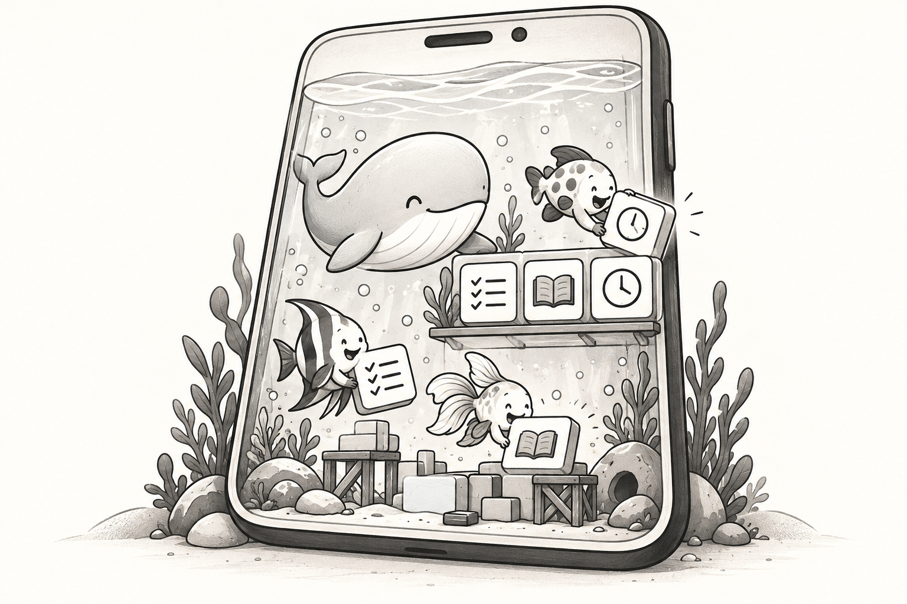
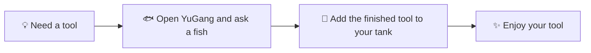
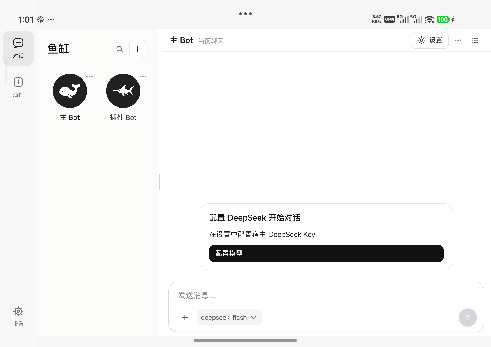
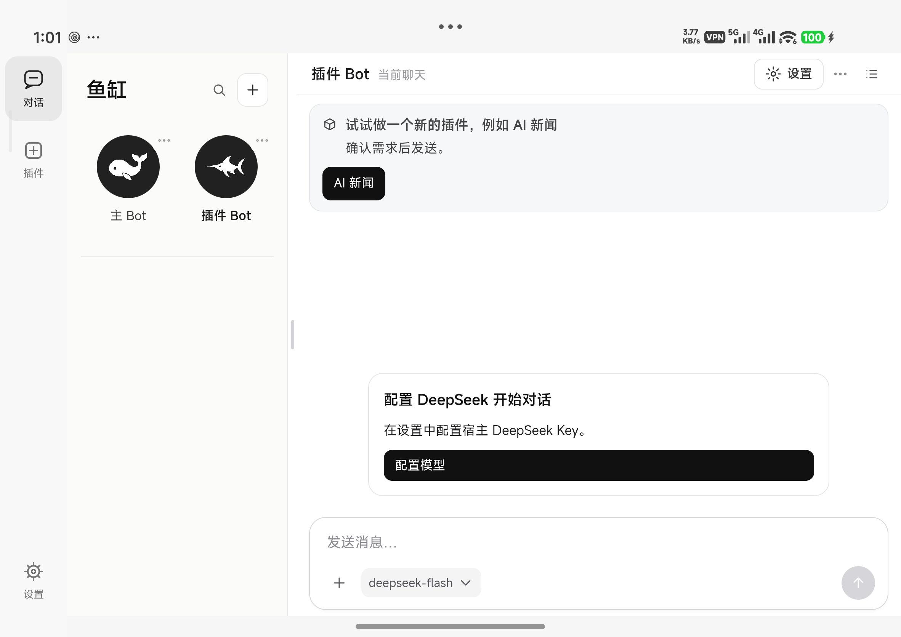
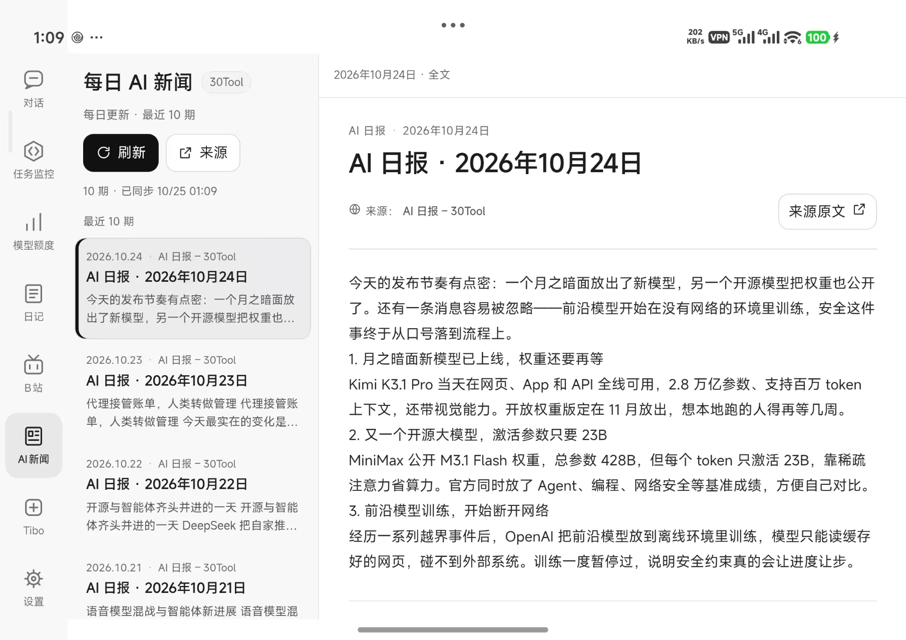

# YuGang (鱼缸)

[中文](README.md)

**Keep different fish (Bots) in your tank, then add plugins to make it fit your needs.**

An open-source Android app built on DeepSeek Agent Harness. Chat with your fish, ask them to build tools, and keep those tools in your own tank.

## How to use it

**Need a tool → Open YuGang and ask a fish → The fish builds it and adds it to your tank → Enjoy your tool.**

Do it all on your phone, without connecting a computer. You can also use a computer as your own remote server for YuGang and connect the services you need.

To begin, tap **Plugins** and tell a fish what you want. The finished tool becomes a plugin in your tank, ready whenever you need it: a reader, a to-do list, or something made just for you.

Bring your own DeepSeek API key. Tasks run on your phone; model inference uses an online service.

## A look inside

**Chat home**

**Plugin guide**

**AI news plugin example (installed separately)**

Screenshots captured on a Xiaomi 18 Fold. Tablet layouts are supported.

## Fish and plugins

“YuGang” means fish tank. DeepSeek is represented by a whale, so the main Bot is the big whale and the other Bots are smaller fish with their own jobs. Each fish has its own role, workspace, memory and chat archives. They can exchange messages and work together.

Plugins are the things you add to your tank. Add what you need; everyone ends up with a different environment.

YuGang provides multi-Bot chat, file and web tools, plus networking, models, media, speech, previews and background tasks for plugins. Build and install plugins as needed; business tools are not preinstalled.

## Setup and development

- Android 10+, ARM64. Background work is subject to your phone's battery policy.
- See [BUILD.md](BUILD.md) to build from source. Building the APK requires a computer; using YuGang and creating plugins on your phone does not.
- [Architecture](ARCHITECTURE.md) · [Plugin API](android/app/src/main/assets/plugin-developer/host-contract.md) · [Contributing](CONTRIBUTING.md)

Accounts, chats, memories and installed plugins stay in your own environment and are not distributed with the source. Plugins and Agent tools share the app identity, so install only trusted code. See [SECURITY.md](SECURITY.md).

## License

YuGang Core is **GPL-3.0-only**. Third-party components retain their own licenses; see [THIRD_PARTY_NOTICES.md](THIRD_PARTY_NOTICES.md).
