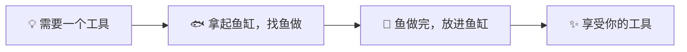

# 鱼缸

[English](README.en.md)

**在鱼缸里养不同的鱼（Bot），再布置插件，满足自己的需求。**

一个基于 DeepSeek Agent Harness 的开源 Android App。和鱼聊天，让鱼帮你做工具，把工具留在自己的鱼缸里。

## 怎么用？

**需要一个工具 → 拿起鱼缸，找鱼做 → 鱼做完，放进鱼缸 → 享受你的工具。**

全程在手机上完成，不用连接电脑。当然，你也可以用电脑搭建自己的鱼缸远端服务器，连接需要的服务。

第一次使用，点左侧的「插件」，把想做的工具告诉鱼。做好的工具会作为插件留在鱼缸里，随时打开使用。比如阅读器、待办清单，或者只适合你自己的小工具。

你需要自己的 DeepSeek API Key。鱼在手机上执行任务，模型推理通过网络调用服务。

## 看看鱼缸

**对话首页**

**插件引导**

**AI 新闻插件示例（独立安装）**

截图来自小米 18 Fold，已适配平板布局。

## 鱼和插件

DeepSeek 的形象是一只鲸鱼。主 Bot 是缸里的大鲸鱼，其他 Bot 是各有分工的小鱼。每条鱼有自己的职责、工作区、记忆和聊天归档，也能互相传消息、一起做事。

插件就像鱼缸里的置景。你需要什么，就往里面布置什么，每个人养出来的鱼缸都不一样。

鱼缸提供多 Bot 对话、文件与网页工具，以及插件需要的网络、模型、媒体、语音、预览和后台能力。插件按需制作、独立安装，不预装业务工具。

## 安装与开发

- Android 10+，ARM64。后台运行受手机系统的电池策略影响。
- 源码构建见 [BUILD.md](BUILD.md)。构建 APK 需要电脑；在手机上使用鱼缸和制作插件不需要连接电脑。
- [架构说明](ARCHITECTURE.md) · [插件开发接口](android/app/src/main/assets/plugin-developer/host-contract.md) · [参与贡献](CONTRIBUTING.md)

账号、聊天、记忆和已安装插件保存在你自己的环境中，不随源码分发。插件与 Agent 工具共享应用身份，请只安装可信代码。详见 [安全说明](SECURITY.md)。

## 开源协议

鱼缸 Core 采用 **GPL-3.0-only**。第三方组件保留各自的许可证，详见 [第三方声明](THIRD_PARTY_NOTICES.md)。
